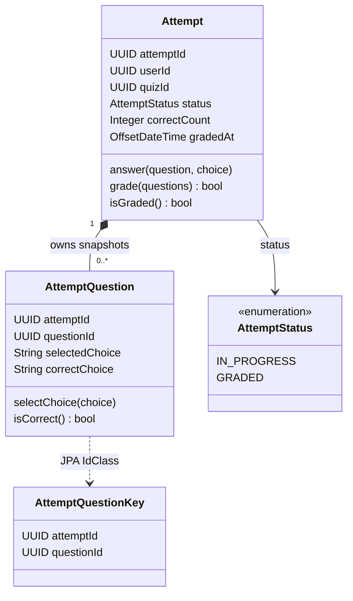
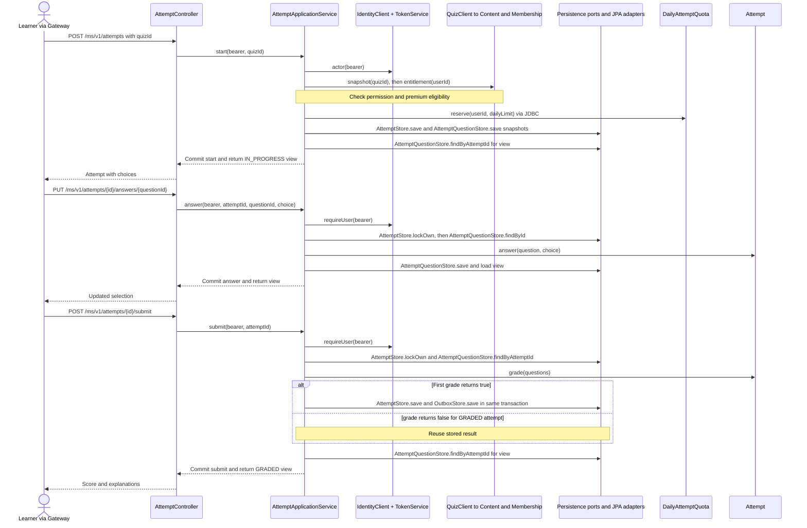

# Assessment Service — Domain-Driven Design

Tài liệu phản ánh Assessment sau khi phân tầng package trên nhánh `refactor/architecture-improvement`, từ baseline `2fd4ed8`. `entrypoints/core/data` là cấu trúc mục tiêu tạm thời vì chưa tìm thấy boilerplate giảng viên. Xem [C4 Level 3](EXAM_ARCHITECTURE.md#c4-level-3--assessment-components).

## 1. Bounded Context và Ubiquitous Language

Assessment sở hữu vòng đời lượt luyện tập, câu hỏi được sao chép vào lượt, câu trả lời, kết quả chấm và số lượt sử dụng theo ngày. `assessment_db` lưu dữ liệu này. Các context trao đổi UUID và hợp đồng API hoặc message.

| Context liên quan | Trách nhiệm và hợp đồng với Assessment |
|---|---|
| Identity | Phát JWT chứa định danh, vai trò và quyền. Assessment xác minh JWT tại chỗ qua `IdentityClient` và `TokenService`. |
| Content | Sở hữu quiz đã xuất bản. `QuizClient` lấy snapshot qua `GET /ms/v1/contents/quizzes/internal/{id}/snapshot` với `X-Service-Key`. |
| Membership | Cung cấp gói và giới hạn theo ngày qua `GET /api/v1/memberships/internal/{userId}`. Assessment thực thi quyền truy cập quiz premium và ghi nhận quota cục bộ. |
| Interaction | Nhận `AttemptGraded` qua RabbitMQ để tạo hoạt động học tập. |

| Thuật ngữ | Nghĩa trong Assessment |
|---|---|
| Attempt / lượt luyện tập | Một lượt của `userId` trên `quizId`, có `attemptId` riêng và trạng thái `IN_PROGRESS` hoặc `GRADED`. |
| Quiz snapshot / bản chụp đề | Danh sách câu hỏi do Content trả về lúc mở lượt. Assessment sao chép đề, bốn phương án, đáp án đúng và giải thích vào từng `AttemptQuestion`. |
| Selected choice / lựa chọn | Một phương án A, B, C hoặc D của người làm bài. Có thể đổi khi lượt đang mở. |
| Submit / nộp bài | Yêu cầu chốt lượt. Application service gọi `Attempt.grade` đồng bộ trong cùng request. |
| Grade / chấm bài | Đếm số câu đúng, ghi `correctCount`, `gradedAt` và chuyển sang `GRADED`. |
| Entitlement / quyền lợi | `plan` và `dailyLimit` do Membership cung cấp khi bắt đầu lượt. |
| Daily quota / hạn mức ngày | Số lượt mở của một người dùng trong ngày UTC, dùng chung cho các quiz. |

## 2. Aggregate Design

[`Attempt`](../assessment-service/src/main/java/com/toeic/assessment/core/Attempt.java) là Aggregate Root. [`AttemptQuestion`](../assessment-service/src/main/java/com/toeic/assessment/core/AttemptQuestion.java) là entity con với khóa ghép `AttemptQuestionKey(attemptId, questionId)` và FK nội bộ đến `attempts`. Root nhận câu hỏi từ application service qua `answer(question, choice)` và `grade(questions)`. Application service tải và lưu câu hỏi bằng port riêng. Quan hệ trong sơ đồ là quan hệ domain, được lưu bằng FK và truy vấn theo `attemptId`.

`DailyAttemptQuota` thực thi chính sách ở phạm vi **người dùng/ngày**, rộng hơn một aggregate `Attempt`. `EventOutbox` là bản ghi phục vụ tích hợp. Hai thành phần dùng bảng riêng.

## 3. Business Invariants và điều kiện use case

| Quy tắc | Điểm thực thi |
|---|---|
| Lượt mới có `userId`, `quizId` và bắt đầu ở `IN_PROGRESS`. Chuyển trạng thái duy nhất trong code là `IN_PROGRESS → GRADED`. | `Attempt` và ràng buộc trạng thái trong migration V1. |
| Chỉ sửa lựa chọn khi lượt đang mở. Câu hỏi phải thuộc lượt và lựa chọn thuộc A–D. | `Attempt.answer`, `AttemptQuestion.selectChoice` và Bean Validation tại `AttemptController`. API trả 409 khi lượt đã chấm, 404 khi thiếu câu hỏi trong lượt và 400 với payload lựa chọn sai. |
| Chấm lần đầu kiểm tra từng câu được truyền vào thuộc lượt, đếm mỗi lựa chọn trùng đáp án đã lưu và ghi thời điểm chấm UTC. Câu bỏ trống tính 0. | `Attempt.grade`, `AttemptQuestion.isCorrect`. Application tải danh sách câu hỏi theo `attemptId`. |
| Nộp lại giữ nguyên điểm, thời điểm chấm và không thêm bản ghi outbox. `answer` và `submit` cùng khóa ghi bi quan hàng `Attempt` theo ID và chủ sở hữu. | `Attempt.grade` trả `false` khi đã chấm. `AttemptApplicationService.submit` chỉ lưu kết quả và outbox khi trả `true`. `AttemptRepo.lockOwn` thực hiện khóa trong transaction. |
| `mine` chỉ liệt kê lượt của người dùng từ JWT. `get`, `answer` và `submit` trả 404 nếu lượt không tồn tại hoặc thuộc người khác. | `AttemptApplicationService` lọc ở truy vấn hoặc kiểm tra kết quả `findById`. |
| Mở lượt cần `assessment:submit` hoặc vai trò `ADMIN`. Quiz premium cần gói `PRO`. Snapshot rỗng bị từ chối. | `TokenService.Actor.can`, `AttemptApplicationService.start`, `QuizClient.snapshot`. `answer` và `submit` xác thực JWT và kiểm tra chủ sở hữu. |
| Mỗi lần mở thành công tiêu thụ một lượt dùng trong ngày UTC. Hết quota trả 429. | `DailyAttemptQuota` dùng PostgreSQL `INSERT … ON CONFLICT … DO UPDATE … WHERE used_count < dailyLimit` theo khóa `(user_id, quota_date)`. Việc giữ quota, lưu lượt và các câu hỏi nằm trong cùng transaction local. Migration V3 tổng hợp các lượt cũ theo UTC. |
| Trước khi chấm, `correct` và `explanation` của từng câu có giá trị `null`. Sau khi chấm, API trả đúng/sai và giải thích. | `AttemptApplicationService.projection` và `AttemptView`. API lượt luyện tập chỉ trả lựa chọn và kết quả hiển thị, không trả trường `correctChoice`. |

## 4. Domain Events và Integration Events

- **Domain Event.** Việc lượt được chấm là sự kiện nghiệp vụ có thể gọi là “lượt luyện tập đã được chấm”. `Attempt.grade` cập nhật trạng thái và trả `boolean`. Domain hiện chưa phát, giữ danh sách hay trả về một đối tượng Domain Event.
- **Integration Event.** Khi chấm lần đầu, `AttemptApplicationService` tạo `EventOutbox` loại `AttemptGraded` và ghi cùng transaction với kết quả. `OutboxPublisher` chạy theo `fixedDelay=3000`, đọc tối đa 20 hàng pending theo `occurredAt` qua `OutboxRepo`, gửi JSON gồm `eventId`, `userId`, `attemptId`, `type` vào exchange `toeic.events` với routing key `attempt.graded`.
- **Tiếp nhận.** Queue durable `interaction.attempt-graded` chuyển message cho `ActivityConsumer`. Consumer kiểm tra `eventId` và lưu `LearningActivity` loại `ATTEMPT_GRADED` với `eventId` là khóa chính. `published` được đặt sau khi lời gọi gửi trả về. Publisher chưa chờ broker confirm và có thể gửi lại cùng `eventId` nếu đã gửi nhưng chưa commit cờ.

## 5. Application Services, Ports và hướng phụ thuộc

[`AttemptApplicationService`](../assessment-service/src/main/java/com/toeic/assessment/core/AttemptApplicationService.java) điều phối `start`, `mine`, `get`, `answer` và `submit`, quản lý transaction và tạo `AttemptView`. `AttemptController` thực hiện routing và kiểm tra payload.

| Port dùng bởi application | Adapter triển khai | Spring Data repository |
|---|---|---|
| `AttemptStore` | `JpaAttemptStore` | `AttemptRepo` |
| `AttemptQuestionStore` | `JpaAttemptQuestionStore` | `AttemptQuestionRepo` |
| `OutboxStore` | `JpaOutboxStore` | `OutboxRepo` |

- Dependency ở mức mã nguồn đi từ controller vào application, rồi vào domain và các persistence port. JPA adapters triển khai port và gọi Spring Data repositories. `OutboxPublisher` thuộc infrastructure và dùng trực tiếp `OutboxRepo` cùng `RabbitTemplate`.
- Application phụ thuộc Spring transaction/HTTP và các lớp cụ thể `IdentityClient`, `QuizClient`, `DailyAttemptQuota`. `OutboxStore` nhận kiểu `EventOutbox` có JPA mapping. `Attempt` và `AttemptQuestion` mang annotation `jakarta.persistence`. Dependency của hai entity này nằm trong model và JPA annotation.
- Đối chiếu dự án mẫu, Assessment áp dụng aggregate giữ quy tắc, port cho đường ghi và test nghiệp vụ không cần khởi động hạ tầng. Dự án mẫu lựa chọn kiến trúc theo độ phức tạp từng context, dùng Domain Events rõ kiểu và có ArchUnit. Assessment dùng JPA trực tiếp trên domain entity và integration outbox để đáp ứng phạm vi MVP. [DDD by Examples — Library](https://github.com/ddd-by-examples/library#general-assumptions)

### Ánh xạ C4 Component → Java Package → Class → Responsibility

Các package trong bảng dùng tiền tố `com.toeic.assessment`. Trước khi phân tầng, toàn bộ lớp và hai bộ test trong bảng cùng nằm ngay tại package gốc.

| C4 component | Java package | Class | Trách nhiệm và dependency qua package |
|---|---|---|---|
| Bootstrap | Package gốc | `AssessmentApplication` | Khởi động Spring Boot và lịch chạy outbox. Package gốc bao phủ component, entity và Spring Data repository scan. |
| REST adapter | `.entrypoints` | `AttemptController`, `AttemptController.Start`, `AttemptController.Answer` | Bind HTTP, validate input, gọi application service và trả `AttemptView`. |
| Use case | `.core` | `AttemptApplicationService`, `AttemptView`, `AttemptView.Question` | Điều phối transaction, thực thi use case, tạo kết quả dùng chung với REST. Giữ DTO kết quả tại nơi tạo để dependency từ REST đi vào core. |
| Domain model | `.core` | `Attempt`, `AttemptQuestion`, `AttemptQuestionKey`, `AttemptStatus` | Chấm và bảo vệ invariant của lượt. JPA repository dùng entity và khóa ghép. Field, hành vi aggregate và constructor nghiệp vụ giữ package-private. |
| Integration record | `.core` | `EventOutbox` | Application tạo bản ghi trong transaction chấm. Publisher đọc ID bằng accessor và đánh dấu qua `markPublished()`. |
| Persistence ports | `.core` | `AttemptStore`, `AttemptQuestionStore`, `OutboxStore` | Hợp đồng lưu trữ cho application, được triển khai trong data. |
| JPA adapters | `.data.persistence` | `JpaAttemptStore`, `JpaAttemptQuestionStore`, `JpaOutboxStore` | Triển khai các port, gọi Spring Data repositories cùng package. |
| Spring Data repositories | `.data.persistence` | `AttemptRepo`, `AttemptQuestionRepo`, `OutboxRepo` | Truy vấn JPA và khóa attempt. `OutboxRepo` có visibility public để publisher tiếp tục polling trực tiếp. |
| JDBC quota | `.data.jdbc` | `DailyAttemptQuota` | Giữ quota nguyên tử bằng JDBC trong transaction mở lượt. |
| HTTP adapter | `.adapters.http` | `QuizClient`, `QuizClient.QuizQuestion`, `QuizClient.Snapshot`, `QuizClient.Entitlement` | Lấy snapshot Content và entitlement Membership. Hai phương thức gọi HTTP và kiểu dữ liệu kết quả được application sử dụng qua package. |
| JWT adapter | `.adapters.security` | `IdentityClient`, `TokenService`, `TokenService.Actor` | Xác minh JWT cục bộ và lấy actor để application quyết định quyền. |
| AMQP publisher và topology | `.adapters.messaging` | `OutboxPublisher`, `MessagingConfig` | Poll qua `OutboxRepo`, gửi RabbitMQ và khai báo exchange/queue/binding. |
| Unit test tương ứng | `.core` trong `src/test/java` | `AttemptDomainTest`, `AttemptApplicationServiceTest` | Giữ quyền truy cập package của test domain và application, dùng mock cho các dependency hiện có. |

`AttemptApplicationService`, `AttemptView`, các kiểu entity và port được dùng qua package có visibility public. `AttemptController`, hai repository attempt và ba JPA adapter vẫn package-private. Spring dùng scanner mặc định đi từ `AssessmentApplication`. JPA tiếp tục dùng field access, tên entity, bảng, khóa ghép và JPQL giữ nguyên.

## 6. Example Mapping

Story: Người học mở một quiz, lưu lựa chọn rồi nộp để nhận kết quả từ snapshot của lượt. Cột **Question** ghi câu hỏi còn mở, chưa phải yêu cầu đã chốt.

| Rule | Example | Question |
|---|---|---|
| Chỉ PRO mở được quiz premium. | Tài khoản FREE có quota vẫn nhận 403 khi mở quiz premium. | Có cần cho phép hoàn tất lượt đã mở nếu người học bị hạ gói? Hiện quyền lợi chỉ được kiểm tra tại `start`. |
| Quota dùng ngày UTC và được giữ nguyên tử. | FREE đã dùng 9/10 lượt. Trong 10 yêu cầu mở đồng thời, kỳ vọng một 200 và chín 429. | Hạn mức theo UTC hay theo ngày địa phương là yêu cầu dài hạn? |
| Câu trả lời thuộc đúng lượt đang mở. | Đổi A thành C trước khi nộp sẽ lưu C. Sau khi chấm, sửa cùng câu trả 409. | Có cần đặt thời hạn làm bài? Hiện chưa có trường hoặc kiểm tra thời hạn. |
| Có thể nộp với câu bỏ trống. | Hai câu có đáp án A và B. Chọn A ở câu đầu và bỏ trống câu sau cho kết quả 1/2. | Quiz nào cần bắt buộc trả lời hết nếu phạm vi được mở rộng? |
| Chỉ lần chấm đầu ghi outbox. | Nộp lại cùng lượt trả điểm cũ. Kỳ vọng nộp đồng thời cũng chỉ tạo một hàng outbox. | Có cần theo dõi thời gian từ commit đến khi hoạt động xuất hiện? |

## 7. Sequence Diagram — Start → Answer → Submit → Grade

## 8. Giới hạn và cải tiến sau MVP

- `Attempt.grade` kiểm tra quyền sở hữu từng câu, còn việc đưa vào đủ tập câu và không trùng dựa vào truy vấn theo `attemptId` và khóa ghép trong DB. `grade` hiện chấp nhận danh sách rỗng khi gọi trực tiếp. Trường trong package và khả năng gọi `selectChoice` trực tiếp hạn chế mức đóng gói invariant. Nên ưu tiên củng cố ranh giới này nếu thêm đường ghi ngoài application service hiện tại.
- Chi phí tách JPA entity khỏi domain hiện gồm mapping và kiểm thử lại giao dịch, khóa và tương thích schema. Giữ mapping trên model cho MVP. Cân nhắc tách entity khi ORM cản trở đóng gói invariant, khi cần mô hình lưu trữ khác hoặc khi boilerplate chính thức yêu cầu tách model.
- Có thể đưa tích hợp HTTP và quota sau port nếu cần kiểm tra dependency bằng module hoặc thay hạ tầng. Thêm Domain Event kiểu riêng khi có luồng nghiệp vụ nội bộ cần tiêu thụ sự kiện. Nếu mục tiêu là tăng độ tin cậy giao message, ưu tiên publisher confirms và cơ chế nhận việc an toàn trước khi chạy nhiều publisher.
- Điểm hiện là số câu đúng. MVP chưa có thời hạn làm bài, bắt buộc trả lời hết hoặc quy đổi điểm TOEIC. Kết quả concurrent submit, khôi phục sau sự cố và hiệu năng cần bằng chứng theo [kế hoạch thực nghiệm](REPORT_TEMPLATE.md#experiment-results-fill-after-actual-tests).
