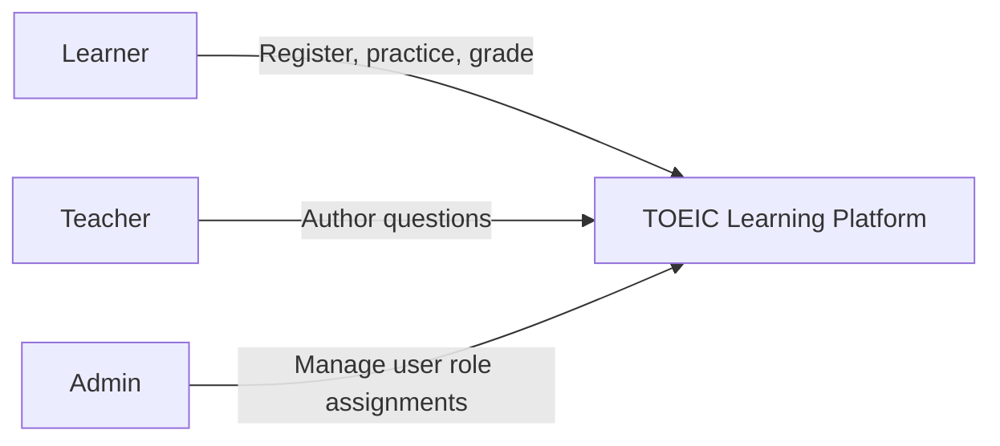
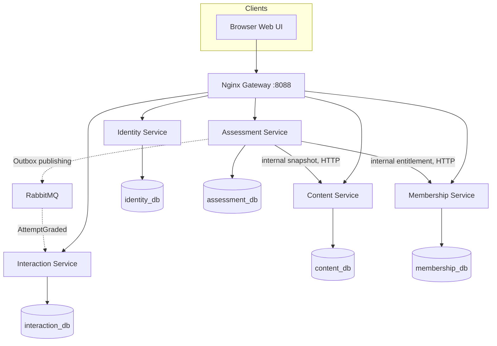
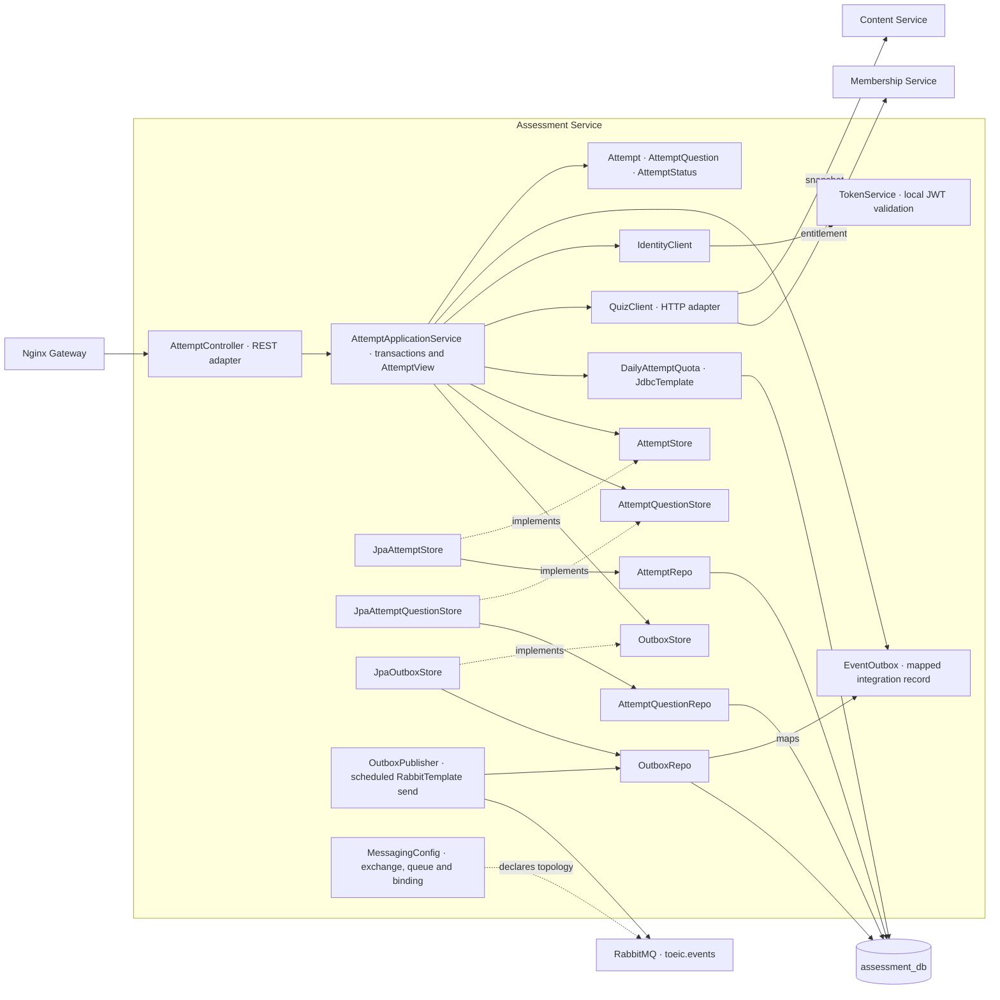
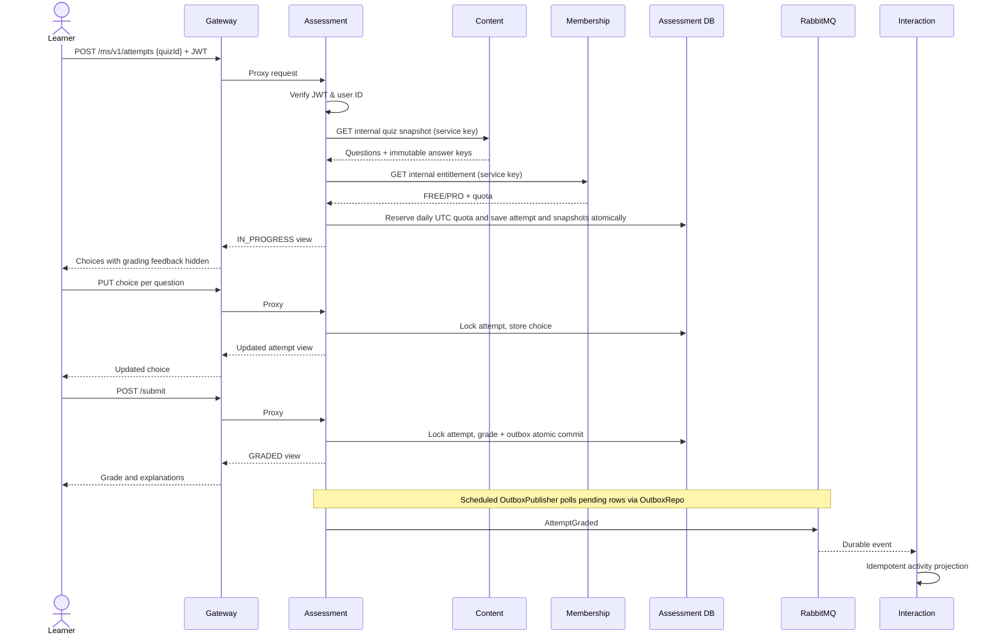
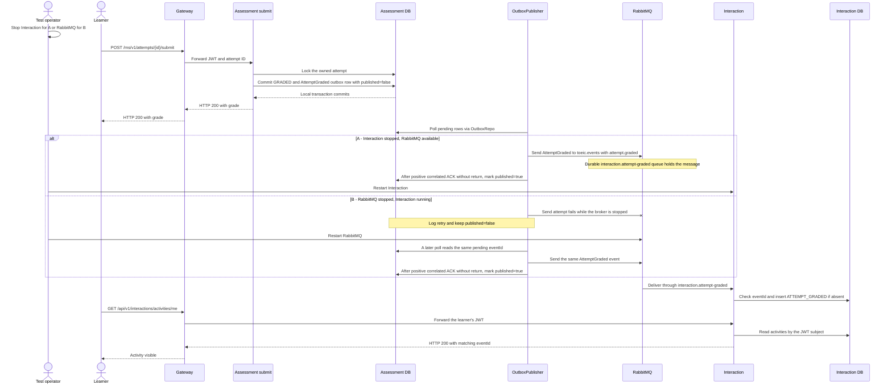
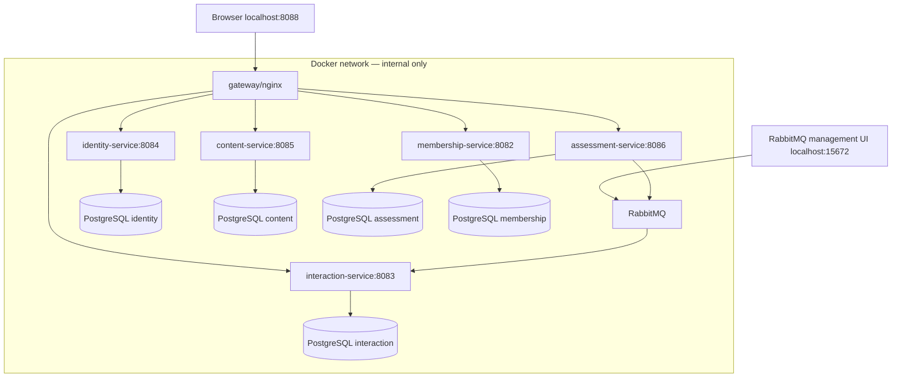

# TOEIC Learning Platform — Microservices MVP Architecture (ADD + arc42 + C4)

> **Current verification (24/11/2026).** [Code baseline `2e2681e`](https://github.com/chienvoxn/toeic-learning-platform-microservices/commit/2e2681eab644f805f6765bb2969126a641088020) and [CI run #7](https://github.com/chienvoxn/toeic-learning-platform-microservices/actions/runs/45244105920) (6/6 PASS). F-02 PostgreSQL, RabbitMQ and combined fixture groups passed locally on checkout `ff9955b`; their full Maven console logs are not yet archived in Git. [QA-03 A/B evidence on `ff9955b`](evidence/qa03-fault-injection-20261124-011437.txt) is archived in the baseline.

**Status:** Five-service demo implemented. See [validation status](VALIDATION_STATUS.md) for prior checks and pending experiments. **Scope:** a bounded exam demonstration, not full original TOEIC feature parity.

## 1. arc42 — Introduction and goals

**Business goal:** TOEIC learner registers, selects TOEIC content, practices, receives a grade, reviews material and accesses plans. Teacher may author quiz after authentication. Relevant stakeholders: Learner, Teacher, Admin, examiner, maintainer.

**Constraints:** KTHDV Hướng 3: IAM (JWT, roles, permissions), core domain resources, interaction, membership, 4+ deployed core services, API Gateway, database ownership, Docker Compose. KTPM: ADD, arc42, C4 L1/L2/L3, 3+ measurable scenarios, 2+ ADR, runtime & deployment view, k6 and fault injection evidence. Each service uses `entrypoints/core/data` packages and groups technical adapters separately. Conformity with the official course boilerplate still requires confirmation.

## 2. arc42 — Architecture constraints and quality goals

### Drivers (ADD)

The table below records the ADD design priority for the MVP. Authorization and submission consistency come first because they protect write operations and learner data. Availability comes next because grading is the core user journey. Quiz-list latency is the measured read-path goal. Modifiability supports subsequent changes to the persistence boundary.

### Quality Attribute Scenarios

| ID | Source | Stimulus | Environment | Artifact | Response | Response Measure |
|---|---|---|---|---|---|---|
| QA-01 Security | Learner with a valid JWT and without `content:write` | Send a valid quiz creation payload to `POST /ms/v1/contents/quizzes`. | Local Compose stack through Gateway, with no other quiz writes between SQL samples. | Content `QuizController`, JWT verification and `content_db.toeic_quizzes`. | Reject the request before inserting the quiz. | HTTP 403. SQL counts for all quizzes and for the run-specific title are unchanged. |
| QA-02 Submission consistency | Owner of one new attempt, acting through 10 synchronized clients | Clients call `POST /ms/v1/attempts/{id}/submit` at the same time after one answer is saved. | Local Compose stack through Gateway with Assessment and PostgreSQL available. | Assessment submit use case, `attempts` and `event_outbox`. | Serialize grading on the attempt row. Commit the grade and outbox together on the first transition, then return the stored result on repeat submits. | 10/10 HTTP 200 with the same `GRADED` result. SQL confirms the saved score and exactly one `AttemptGraded` outbox row for the attempt. |
| QA-03 Availability | Learner and test operator | Submit a new attempt while the operator stops Interaction (A) or RabbitMQ (B), then restart the stopped dependency. | Local Compose stack, one fault at a time. Assessment and its PostgreSQL remain available. | Assessment submit and outbox, RabbitMQ queue and Interaction activity projection. | Return the grade during the outage. A queues the event while the consumer is down. B retains the pending outbox row until the broker is available. After recovery, record the activity. | HTTP 200 and a persisted grade during both outages. A observes a ready message with zero consumers. B observes `published=false` while RabbitMQ is stopped. Within the 60 s observation window after Compose reports the restarted service running or healthy, the same `eventId` is published and visible in Interaction SQL and its authenticated API. |
| QA-04 Performance | k6 clients | 50 VUs request `GET /ms/v1/contents/quizzes` for 60 s, with 500 ms think time. | Local Compose stack, Gateway on loopback, seeded quiz catalog, no authentication required. | Nginx Gateway, Content list handler, its repositories and `content_db`. | Return the public quiz list as JSON with no answers or explanations. | p95 < 500 ms, `http_req_failed` < 1%, and all HTTP/JSON/payload checks pass. |

The response measures are TOEIC project targets. The QA-03 window comes from the test protocol. The supporting modifiability scenario M-01 is a proposed exercise. A maintainer replaces a persistence adapter behind its existing port on a development branch, the Assessment use case retains its behavior, and the measure is zero changes to `AttemptApplicationService` with its unit tests passing. [QA-03 test protocol](../tests/fault_injection.md)

### ADD traceability

| Driver (design priority) | Quality Attribute Scenario | Tactic | Component | ADR | Test Evidence |
|---|---|---|---|---|---|
| D01 · Security | QA-01 | Verify signed JWT locally and require the authoring permission before a write. Check attempt ownership on reads and writes. | Identity `RbacService` / `TokenService`, Content `QuizController`, Assessment `AttemptApplicationService`. | [ADR-002](ADR_MVP.md#adr-002--jwt-access-tokens-for-identity) | Learner authoring returned 403 and the total quiz count stayed 2 → 2. The log also records role grants and non-owner access checks. [QA-01 log](evidence/qa01-security-rbac-aa43453.txt) |
| D02 · Consistency | QA-02 | Use a pessimistic row lock and one state transition. Commit grade and outbox in the same local transaction. | `AttemptApplicationService`, `Attempt`, `AttemptRepo.lockOwn`, `OutboxStore`, `assessment_db`. | [ADR-006](ADR_MVP.md#adr-006--attempt-as-the-assessment-aggregate-root) · [ADR-003](ADR_MVP.md#adr-003--rabbitmq--transactional-outbox) | 10 identical HTTP 200 grades and one SQL outbox row. [QA-02 log](evidence/qa02-concurrent-submit.txt) |
| D03 · Availability | QA-03 A/B | Keep scoring independent of messaging. Poll pending outbox records, use the durable queue and deduplicate activity by event ID. | `OutboxPublisher`, `OutboxRepo`, RabbitMQ, `ActivityConsumer` and `ActivityRepo`. | [ADR-003](ADR_MVP.md#adr-003--rabbitmq--transactional-outbox) | Grade persisted in each outage. Queue and SQL samples plus the activity API confirm both recovery paths. [QA-03 log](evidence/qa03-fault-injection-20261122-134619.txt) |
| D04 · Quiz-list performance | QA-04 | Keep the public read on the Content service and its own database. Serialize a compact `QuizView`. | Nginx, `QuizController.list`, `QuizRepo` and `QuizQuestionRepo`. | [ADR-001](ADR_MVP.md#adr-001--five-business-services-vs-one-modular-monolith) · [ADR-004](ADR_MVP.md#adr-004--postgresql-per-service) | 5,793 requests at 95.76 req/s, p95 29.18 ms and zero HTTP or validation failures on the seeded local stack. [k6 summary](evidence/qa04-k6-20261122-summary.json) |
| D05 · Persistence modifiability | M-01 · Proposed adapter replacement | Put persistence calls behind use-case-facing interfaces. | `AttemptStore`, `AttemptQuestionStore`, `OutboxStore` and the `Jpa*Store` implementations. | [ADR-007](ADR_MVP.md#adr-007--persistence-ports-for-assessment-use-cases) | Unit tests exercise orchestration with mocked stores. A real adapter replacement has yet to be measured. [Application tests](../assessment-service/src/test/java/com/toeic/assessment/core/AttemptApplicationServiceTest.java) |

Evidence applies to its recorded run. QA-01 records checkout `aa43453`, QA-03 records `f191b7a`, and QA-04 records `19aa006`. The archived QA-02 log records its run time and attempt ID, with no checkout SHA. These results support the decisions above at the respective run conditions.

## 3. arc42 — Context and scope (C4 Level 1)

| External actor | Interactions |
|---|---|
| Learner | manage own profile, view quizzes, practice, feedback, membership |
| Teacher | manage own profile, author and publish owned drafts |
| Admin | manage own profile, search accounts, grant roles and moderate quiz visibility |

Examiner is an assessment stakeholder who reviews the demo and evidence. The runtime role catalog contains Learner, Teacher and Admin. [Identity RBAC migration](../identity-service/src/main/resources/db/migration/V3__rbac.sql) · [Admin UI](../web/app.js)

## 4. arc42 — Solution strategy

- Strategic DDD separates **Identity**, **Content**, **Assessment**, **Interaction**, **Membership** bounded contexts.
- Synchronous HTTP for immediate read results: Assessment → Content snapshot and Assessment → Membership entitlement.
- Event-driven propagation for noncritical read activity: Assessment's **transactional outbox** → RabbitMQ → Interaction activity projection.
- Immutable attempt question snapshots prevent future content edits from changing historical grades.
- PostgreSQL per service (ownership boundary); cross-DB references are bare UUIDs, never physical cross-DB foreign keys.
- Nginx as the only public API entry point, with internal routes blocked. Internal auth uses service key; external auth uses signed JWT.

## 5. arc42 — Building block view (C4 Level 2)

### C4 Level 3 — Assessment components

The application depends on persistence port interfaces and Spring injects the JPA implementations. `AttemptRepo.lockOwn` supplies the pessimistic write lock. The scheduled publisher reads and updates the outbox directly through `OutboxRepo`. `MessagingConfig` declares the durable exchange, queue and binding. Domain entities retain JPA mappings, and the application still calls the concrete JWT, HTTP and JDBC components shown above. [C4 component-to-package mapping](ASSESSMENT_DDD.md#ánh-xạ-c4-component--java-package--class--responsibility)

### C4 component-to-package mapping for Identity, Content, Membership and Interaction

Each package is relative to `com.toeic.<service>`. The `IdentityApplication`, `ContentApplication`, `MembershipApplication` and `InteractionApplication` bootstrap classes stay at their service roots for Spring component, entity and repository discovery.

| Service | C4 component and responsibility | Java package | Class |
|---|---|---|---|
| Identity | Registration, login, self-service Profile and Admin directory HTTP API | `entrypoints` | `IdentityDirectoryController` |
| Identity | User model and demo account provisioning | `core` | `IdentityUser`, `DemoTeacherProvisioner` |
| Identity | User persistence | `data.persistence` | `IdentityUserRepository` |
| Identity | Paginated account directory, role validation, grants and permission lookups through JDBC | `data.jdbc` | `RbacService` |
| Identity | JWT signing and verification | `adapters.security` | `TokenService` |
| Content | Public quizzes, owned drafts, Admin visibility, internal snapshot and learning-resource APIs | `entrypoints` | `QuizController`, `ResourceController` |
| Content | Quiz, question and learning resource models | `core` | `Quiz`, `QuizQuestion`, `LearningResource` |
| Content | Quiz, question and resource persistence | `data.persistence` | `QuizRepo`, `QuizQuestionRepo`, `ResourceRepository` |
| Content | Local JWT verification and actor access | `adapters.security` | `TokenService`, `IdentityClient` |
| Membership | Entitlement and demo plan change HTTP API | `entrypoints` | `MembershipController` |
| Membership | Membership and plan state | `core` | `Membership` |
| Membership | Membership persistence | `data.persistence` | `MembershipRepository` |
| Membership | Local JWT verification and actor access | `adapters.security` | `TokenService`, `IdentityClient` |
| Interaction | Review and learner activity HTTP API | `entrypoints` | `InteractionController`, `ActivityController` |
| Interaction | Review and activity models | `core` | `ContentReview`, `LearningActivity` |
| Interaction | Review and activity persistence | `data.persistence` | `ContentReviewRepository`, `ActivityRepo` |
| Interaction | Graded-attempt consumer and RabbitMQ topology | `adapters.messaging` | `ActivityConsumer`, `ActivityMessaging` |
| Interaction | Local JWT verification and actor access | `adapters.security` | `TokenService`, `IdentityClient` |

## 6. arc42 — Runtime view

### Scenario: Profile and Admin moderation

1. Web calls Identity through the Gateway to read or update the actor's Profile. Identity derives the user from the verified JWT. Name changes update `displayName`. Password changes validate the current password and store a new BCrypt hash. Issued tokens remain valid until expiration.
2. Admin lists accounts through Identity and grants a role to a selected user. Identity requires `rbac:manage`. The directory returns all roles on each listed account without credential fields. The existing JWT keeps its original claims until the user signs in again.
3. Admin lists or inspects quizzes through Content, then sends the current `version` and the desired `published` value. Content verifies `rbac:manage`, locks its quiz row and returns 409 for a stale version. Republishing validates the quiz. Teacher draft writes use the same row-lock boundary and additionally require ownership.
4. Hiding removes the quiz from the public catalog and unavailable snapshots return 404 to new opens. Assessment can still submit a previously opened attempt using its persisted copy and return the stored grade to its owner.

The workspace reads totals from the Identity and Content pagination contracts. Its author column uses the optional Content UUID. Identity has no protected lookup by author UUID in this revision. [API routes](../README.md#6-dịch-vụ-và-tuyến-api) · [Live evidence](SUBMISSION_EVIDENCE.md).

### Scenario: Start, answer and submit practice

### QA-03 availability and recovery

This is the selected runtime scenario for the evaluation. Each branch uses a different attempt and event ID. The test operator stops the relevant dependency before the learner starts and submits the attempt.

The publisher polls with a 3 s fixed delay. It uses mandatory routing and correlated publisher confirms: only a positive broker ACK without a returned message allows `published=true`. A NACK, `NO_ROUTE`, timeout or connection failure leaves the row pending; a failed database mark-published commit *after* a broker ACK can cause redelivery, which Interaction deduplicates by event ID. The latest QA-03 A/B run on checkout `ff9955b` observed HTTP 200 grading during both outages and matching activities after recovery: **29.36 s** (A) and **32.14 s** (B), measured *from submit to activity*. The older run reported **12.70 s** and **16.17 s** *from Compose restoration to observation*; these are different timing origins. [Latest QA-03 log](evidence/qa03-fault-injection-20261124-011437.txt) · [Archived QA-03 log](evidence/qa03-fault-injection-20261122-134619.txt) · [OutboxPublisher](../assessment-service/src/main/java/com/toeic/assessment/adapters/messaging/OutboxPublisher.java) · [ActivityConsumer](../interaction-service/src/main/java/com/toeic/interaction/adapters/messaging/ActivityConsumer.java)

## 7. arc42 — Deployment view (Docker Compose)

## 8. arc42 — Crosscutting concepts

- **Security.** BCrypt for identity password storage. Services verify HMAC-SHA256, expiration, issuer and audience, and derive the actor UUID from the token. Identity and Content enforce `rbac:manage` for Admin endpoints. Content limits Teacher writes to drafts owned by the actor. The Gateway blocks internal snapshot and entitlement routes.
- **Data integrity:** pessimistic lock on attempt for save/submit; idempotent submit; immutable snapshots; outbox saved inside grading transaction. No distributed transaction across Content/Membership and Assessment, because snapshot and entitlement are read before local commit. A membership changing concurrently can produce an entitlement race—acceptable for this educational MVP, not a billing guarantee.
- **Observability:** `docker compose logs`, RabbitMQ dashboard, health by endpoint; structured traces not implemented.
- **Data and privacy:** each database belongs to a single service. The public review GET exposes reviewer UUID. Interaction activity is queried by the user from the verified token.
- **API resilience:** direct synchronous service calls with timeouts; circuit breaker/retry are suggested production extensions, not implemented.

## 9. arc42 — Architectural decisions

See [ADR-001 to ADR-008](ADR_MVP.md) for service boundaries, JWT, transactional outbox, data ownership, the demo UI, Assessment and Admin moderation.

## 10. arc42 — Quality requirements

Use the [six-field QA-01 to QA-04 definitions](#quality-attribute-scenarios) and [ADD traceability](#add-traceability) to compare targets with the archived results. The [report template](REPORT_TEMPLATE.md) groups the measured evidence and the KTHDV diagrams.

## 11. arc42 — Risks & technical debt

1. **Not full production TOEIC migration**: original React web/mobile, RAG, SRS and exam bank not ported.
2. **Symmetric signing key shared with all services**: change to RS256/EdDSA JWKS and key rotation.
3. **No instant token revocation**: short-lived 30min token; implement central revocation/version check if required.
4. **Demo-only membership plan upgrade**: users can self-activate PRO when flag is true; never accept as paid entitlement.
5. **Outbox is at-least-once, not exactly-once**: correlated broker confirms and mandatory returns are implemented, but broker ACK and SQL `published` commit are not atomic. Retry may produce duplicates; Interaction deduplicates by event ID. Multi-publisher coordination and DLQ remain out of scope.
6. **Assessment dependency boundaries**. The application and domain share the core package, and the application depends on concrete HTTP, JWT and JDBC adapters. [Assessment DDD review](ASSESSMENT_DDD.md#8-giới-hạn-và-cải-tiến-sau-mvp)
7. **Runtime evidence scope**. QA-01 and the archived QA-02/QA-04 runs have their own recorded environments and revision metadata. New QA-03 A/B and F-02 groups were run at checkout `ff9955b`; QA-03 evidence is committed in baseline `2e2681e`, but complete F-02 console logs have not yet been archived. CI at `2e2681e` passed 6/6 jobs and does not itself run external integration/fault-injection fixtures. [Validation status](VALIDATION_STATUS.md)
8. **Admin limits.** Content stores one visibility flag. A hidden quiz shares the draft state, and an eligible owner can edit and publish it again. The upgrade supports additive grants. Role revocation and a moderation audit trail are outside this release. [ADR-008](ADR_MVP.md#adr-008--admin-boundaries-and-versioned-quiz-visibility)

## 12. arc42 — Glossary

| Term | Definition |
|---|---|
| Bounded Context | Autonomous ownership of a business model |
| Aggregate | Consistency boundary inside one domain |
| Assessment snapshot | Immutable content copied into attempt at its creation |
| Outbox | Local table atomically recording events before async publish |
| Entitlement | Membership right that gates access to premium quiz |
| API Gateway | Public ingress that routes requests to independent services |
