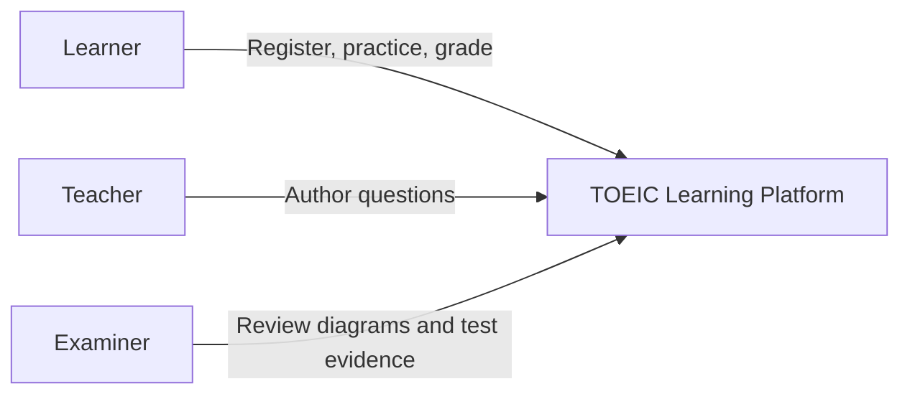
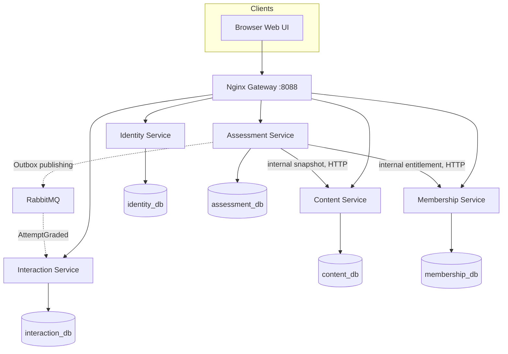
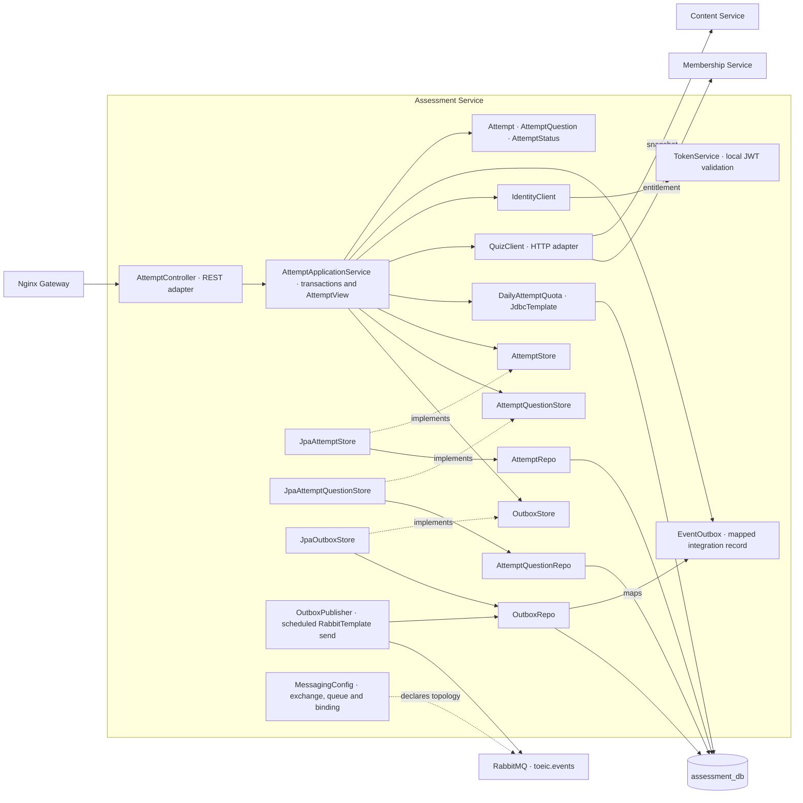
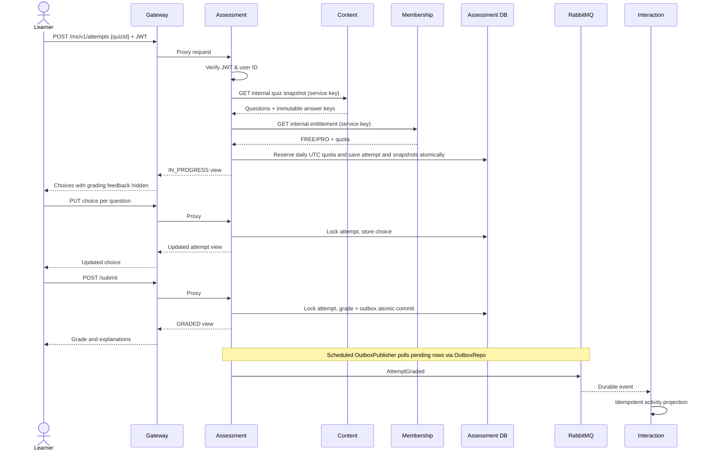
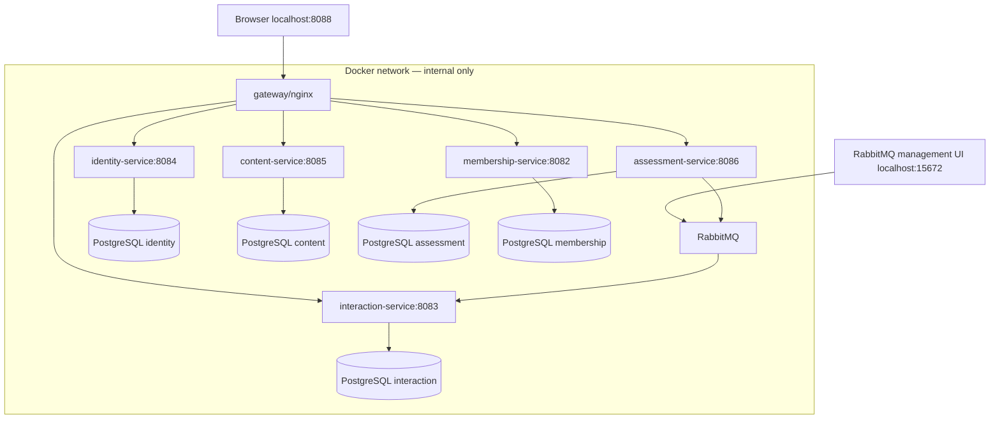

# TOEIC Learning Platform — Microservices MVP Architecture (ADD + arc42 + C4)

**Status:** Five-service demo implemented. See [validation status](VALIDATION_STATUS.md) for prior checks and pending experiments. **Scope:** a bounded exam demonstration, not full original TOEIC feature parity.

## 1. arc42 — Introduction and goals

**Business goal:** TOEIC learner registers, selects TOEIC content, practices, receives a grade, reviews material and accesses plans. Teacher may author quiz after authentication. Relevant stakeholders: Learner, Teacher, Admin, examiner, maintainer.

**Constraints:** KTHDV Hướng 3: IAM (JWT, roles, permissions), core domain resources, interaction, membership, 4+ deployed core services, API Gateway, database ownership, Docker Compose. KTPM: ADD, arc42, C4 L1/L2/L3, 3+ measurable scenarios, 2+ ADR, runtime & deployment view, k6 and fault injection evidence. Each service uses `entrypoints/core/data` packages and groups technical adapters separately. Conformity with the official course boilerplate still requires confirmation.

## 2. arc42 — Architecture constraints and quality goals

### Drivers (ADD)

1. **Security:** no one can access another learner's attempts; learners cannot author exam keys; JWT signature is verified inside services.
2. **Consistency:** grading is atomic/idempotent; grade and outbox are committed in one local DB transaction.
3. **Availability:** Interaction outage should not break Assessment grading; events are queued for later.
4. **Modifiability:** new content/question types can be added without direct cross-service DB access.
5. **Performance:** read-only quiz list is lightweight; use measurement rather than assumption.

### Quality Attribute Scenarios

| ID | Source / stimulus / environment | Artifact / response | Proposed acceptance / evidence |
|---|---|---|---|
| QA-01 Security | Unprivileged learner sends `POST /ms/v1/contents/quizzes` with valid learner JWT | Content rejects without writing rows | HTTP 403; query COUNT unchanged; negative smoke test |
| QA-02 Reliability | 10 concurrent submissions for one attempt under normal load | Assessment locks the attempt row and persists one grade and one outbox row | All 10 return HTTP 200 and the same grade. DB outbox count = 1 for that attempt. |
| QA-03 Availability | Interaction unavailable while user submits a valid attempt | Assessment commits grade/outbox, provides score without waiting for consumer | submit HTTP 200 during failure, activity appears eventually after recovery |
| QA-04 Performance | 50 virtual users continuously request quiz list from local Docker stack for 1 minute | Gateway + Content return sanitized quiz list | target p95 under 500 ms, failed requests under 1%; k6 report |

Targets are **proposed** for TOEIC domain, not numbers stated by your two exam PDFs, and need measured results.

## 3. arc42 — Context and scope (C4 Level 1)

| External actor | Interactions |
|---|---|
| Learner | register/sign in, view quizzes, practice, feedback, membership |
| Teacher | authenticated creation of new quizzes |
| Examiner | observe demo, network failure and performance tests |

## 4. arc42 — Solution strategy

- Strategic DDD separates **Identity**, **Content**, **Assessment**, **Interaction**, **Membership** bounded contexts.
- Synchronous HTTP for immediate read results: Assessment → Content snapshot and Assessment → Membership entitlement.
- Event-driven propagation for noncritical read activity: Assessment's **transactional outbox** → RabbitMQ → Interaction activity projection.
- Immutable attempt question snapshots prevent future content edits from changing historical grades.
- PostgreSQL per service (ownership boundary); cross-DB references are bare UUIDs, never physical cross-DB foreign keys.
- Nginx as the only public API entry point, with internal routes blocked. Internal auth uses service key; external auth uses signed JWT.

## 5. arc42 — Building block view (C4 Level 2)

### C4 Level 3 — Assessment components

The application depends on persistence port interfaces and Spring injects the JPA implementations. `AttemptRepo.lockOwn` supplies the pessimistic write lock. The scheduled publisher reads and updates the outbox directly through `OutboxRepo`. `MessagingConfig` declares the durable exchange, queue and binding. Domain entities retain JPA mappings, and the application still calls the concrete JWT, HTTP and JDBC components shown above. [C4 component-to-package mapping](ASSESSMENT_DDD.md#ánh-xạ-c4-component--java-package--class--responsibility)

### C4 component-to-package mapping for Identity, Content, Membership and Interaction

Each package is relative to `com.toeic.<service>`. The `IdentityApplication`, `ContentApplication`, `MembershipApplication` and `InteractionApplication` bootstrap classes stay at their service roots for Spring component, entity and repository discovery.

| Service | C4 component and responsibility | Java package | Class |
|---|---|---|---|
| Identity | Registration, login and role-management HTTP API | `entrypoints` | `IdentityDirectoryController` |
| Identity | User model and demo account provisioning | `core` | `IdentityUser`, `DemoTeacherProvisioner` |
| Identity | User persistence | `data.persistence` | `IdentityUserRepository` |
| Identity | Role validation, grants and permission lookups through JDBC | `data.jdbc` | `RbacService` |
| Identity | JWT signing and verification | `adapters.security` | `TokenService` |
| Content | Quiz, snapshot and learning resource HTTP API | `entrypoints` | `QuizController`, `ResourceController` |
| Content | Quiz, question and learning resource models | `core` | `Quiz`, `QuizQuestion`, `LearningResource` |
| Content | Quiz, question and resource persistence | `data.persistence` | `QuizRepo`, `QuizQuestionRepo`, `ResourceRepository` |
| Content | Local JWT verification and actor access | `adapters.security` | `TokenService`, `IdentityClient` |
| Membership | Entitlement and demo plan change HTTP API | `entrypoints` | `MembershipController` |
| Membership | Membership and plan state | `core` | `Membership` |
| Membership | Membership persistence | `data.persistence` | `MembershipRepository` |
| Membership | Local JWT verification and actor access | `adapters.security` | `TokenService`, `IdentityClient` |
| Interaction | Review and learner activity HTTP API | `entrypoints` | `InteractionController`, `ActivityController` |
| Interaction | Review and activity models | `core` | `ContentReview`, `LearningActivity` |
| Interaction | Review and activity persistence | `data.persistence` | `ContentReviewRepository`, `ActivityRepo` |
| Interaction | Graded-attempt consumer and RabbitMQ topology | `adapters.messaging` | `ActivityConsumer`, `ActivityMessaging` |
| Interaction | Local JWT verification and actor access | `adapters.security` | `TokenService`, `IdentityClient` |

## 6. arc42 — Runtime view

### Scenario: Start, answer and submit practice

**Failure narrative:** The durable Interaction queue can hold successfully routed messages while the consumer is down. If the send throws during a broker outage, the row remains pending for a later poll. Publisher confirms are absent, so the `published` flag alone cannot demonstrate broker receipt. Recovery scenarios are pending in the [validation status](VALIDATION_STATUS.md).

## 7. arc42 — Deployment view (Docker Compose)

## 8. arc42 — Crosscutting concepts

- **Security:** BCrypt for identity password storage; role/permission claims; Signature HMAC-SHA256 and exp, iss, aud verification; UUID actor always sourced from token. Internal service key not exposed through Gateway.
- **Data integrity:** pessimistic lock on attempt for save/submit; idempotent submit; immutable snapshots; outbox saved inside grading transaction. No distributed transaction across Content/Membership and Assessment, because snapshot and entitlement are read before local commit. A membership changing concurrently can produce an entitlement race—acceptable for this educational MVP, not a billing guarantee.
- **Observability:** `docker compose logs`, RabbitMQ dashboard, health by endpoint; structured traces not implemented.
- **Data and privacy:** each database belongs to a single service. The public review GET exposes reviewer UUID. Interaction activity is queried by the user from the verified token.
- **API resilience:** direct synchronous service calls with timeouts; circuit breaker/retry are suggested production extensions, not implemented.

## 9. arc42 — Architectural decisions

See [ADR-001 to ADR-007](ADR_MVP.md) for service boundaries, JWT, transactional outbox, database ownership, demo UI, the Assessment aggregate and persistence ports.

## 10. arc42 — Quality requirements

QA-01 to QA-04 above. Use [smoke](../tests/smoke.py), [k6](../tests/load.js) and [fault injection](../tests/fault_injection.md). Record results in the [report template](REPORT_TEMPLATE.md).

## 11. arc42 — Risks & technical debt

1. **Not full production TOEIC migration**: original React web/mobile, RAG, SRS and exam bank not ported.
2. **Symmetric signing key shared with all services**: change to RS256/EdDSA JWKS and key rotation.
3. **No instant token revocation**: short-lived 30min token; implement central revocation/version check if required.
4. **Demo-only membership plan upgrade**: users can self-activate PRO when flag is true; never accept as paid entitlement.
5. **Outbox publisher confirmations not implemented**: broker accepted/ack not tracked; use confirms and retry-safe transitions.
6. **Assessment dependency boundaries**. The application and domain share the core package, and the application depends on concrete HTTP, JWT and JDBC adapters. [Assessment DDD review](ASSESSMENT_DDD.md#8-giới-hạn-và-cải-tiến-sau-mvp)
7. **Pending runtime evidence**: archive environment and test outputs, then measure performance, concurrent submit and fault recovery.

## 12. arc42 — Glossary

| Term | Definition |
|---|---|
| Bounded Context | Autonomous ownership of a business model |
| Aggregate | Consistency boundary inside one domain |
| Assessment snapshot | Immutable content copied into attempt at its creation |
| Outbox | Local table atomically recording events before async publish |
| Entitlement | Membership right that gates access to premium quiz |
| API Gateway | Public ingress that routes requests to independent services |
