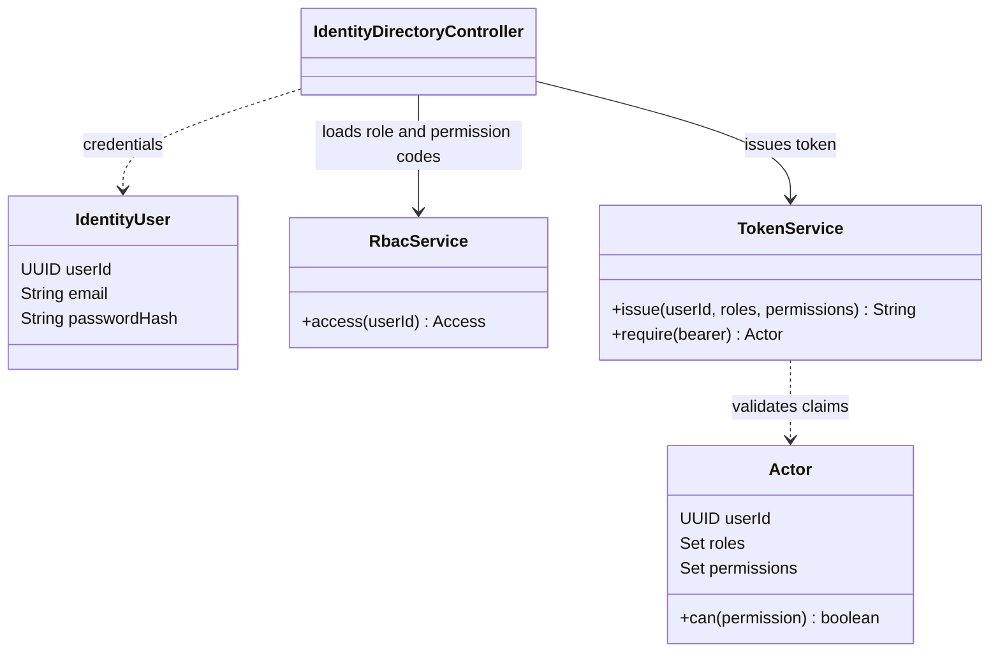
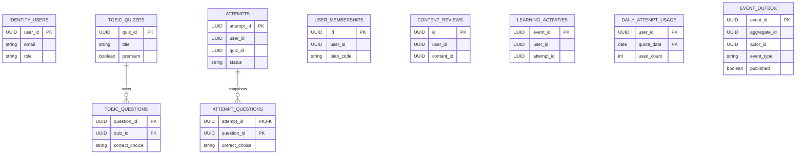

# Báo cáo KTHDV & KTPM — Bảng bằng chứng thực nghiệm

**Chỉ điền số liệu từ lần chạy có bằng chứng.** [Trạng thái xác minh](VALIDATION_STATUS.md) ghi nguồn kết quả và các phép thử còn thiếu.

## I. KTHDV — Hướng 3

| Tiêu chí | Bằng chứng cần chụp | Kết quả |
|---|---|---|
| 5 independent Core Microservices | `docker compose ps`, image/service logs | Đã cấu hình. Chờ ảnh runtime. |
| Independent Gateway | network tab: UI → :8088, nginx routes | Đã cấu hình. Smoke trước đó được báo đạt, chờ log và ảnh. |
| 5 databases | `docker compose exec <db> psql ... \l` | Có cấu hình và migrations riêng. Chờ ảnh hoặc output DB. |
| JWT roles/permissions | login response (redact JWT), decoding header/payload, denied learner authoring | Smoke trước đó được báo đạt. Chờ log. |
| Interaction records reviews + activity | UI screenshot and `interaction_db` rows | Smoke trước đó được báo đạt. Chờ log. |
| Membership FREE vs PRO | free 403 for premium, demo PRO allows it | Smoke trước đó được báo đạt. Chờ log để xác nhận nhánh PRO. |
| No cross-database FK | ERD and migrations in each service | Đối chiếu migrations và mô hình sở hữu database. |
| Docker Compose | `docker compose config --quiet` & full stack boot | Config exit 0. Chờ bằng chứng full stack boot. |

### Class diagram for RBAC

`RbacService` reads role and permission assignments from `identity_user_roles` and `identity_role_permissions` using JDBC.

### ERD ownership (abbreviated)

`user_id`, `content_id`, `quiz_id` in other databases are IDs **without cross-database foreign keys**.

## II. KTPM — ADD / arc42 / C4

- arc42 1/3/4/5/6/7/9/10 sections are in the [architecture document](EXAM_ARCHITECTURE.md).
- At least 3 Quality Attribute Scenarios: QA-01, QA-02, QA-03, QA-04.
- Seven ADRs, including the Assessment aggregate and persistence ports. [ADR log](ADR_MVP.md)
- C4 L1, L2, L3 and Runtime/Deployment Mermaid diagrams in architecture file.
- Assessment bounded context, aggregate, invariants and Example Mapping. [Assessment DDD](ASSESSMENT_DDD.md)

### Experiment results (fill after actual tests)

| Experiment | Command | Expected | Observed | Screenshot |
|---|---|---|---|---|
| Assessment unit tests | `mvn -f assessment-service/pom.xml test` | domain rules and use-case orchestration | 12 passed in existing Surefire reports | Archive the two reports with run metadata. |
| Functional smoke | `python tests/smoke.py` | all enabled assertions pass | 10 checks passed per project owner | Raw output pending. |
| Daily quota concurrency | `python tests/test_quota_concurrency.py` | after 9 starts, parallel starts yield 1 HTTP 200 and 9 HTTP 429, total 10 | Passed per project owner | Raw output pending. |
| Performance 50 VUs / 1m | `k6 run tests/load.js` | p95 < 500ms, errors <1% | [PENDING] | [PENDING] |
| Interaction down | stop service then submit | grade success, event later visible | [PENDING] | [PENDING] |
| RabbitMQ down | stop broker then submit | grade success, pending row during outage and activity after recovery | [PENDING] | [PENDING] |
| No cross-user read | use another learner token | 404 / denied | Covered by unit test and reported smoke | Raw smoke output pending. |
| Concurrent submit | 10 submits concurrently | 10 HTTP 200, same status and score, one outbox row | [PENDING] | [PENDING] |

#### Kế hoạch chạy các phép thử còn thiếu

1. **k6 (QA-04).** Xác nhận danh sách quiz hoạt động qua Gateway. Chạy `k6 run tests/load.js` với 50 VUs trong 1 phút. Lưu output, exit code, p95, `http_req_failed`, tổng số request và tỷ lệ check. Chấp nhận khi p95 < 500 ms và lỗi < 1%. Phép thử đo endpoint danh sách quiz.
2. **Concurrent submit (QA-02).** Tạo một attempt mới, lưu lựa chọn có điểm kỳ vọng và xác nhận `IN_PROGRESS`. Dùng 10 worker khởi phát cùng lúc, cùng JWT chủ sở hữu và cùng `attemptId`, gọi `POST /ms/v1/attempts/{id}/submit`. Lưu từng HTTP status, body đã lọc và thời gian. Đối chiếu `attempts` có một kết quả `GRADED` với điểm kỳ vọng, và `event_outbox` có đúng một dòng lọc theo `aggregate_id` và `event_type = 'AttemptGraded'`. Lặp với lượt mới để tránh đo một lượt đã chấm sẵn.
3. **Fault injection (QA-03 và mất broker).** Dùng một attempt mới cho mỗi kịch bản trong [quy trình fault injection](../tests/fault_injection.md). Dừng Interaction, nộp bài trong khi service dừng, rồi khởi động lại và tìm `ATTEMPT_GRADED` theo đúng `attemptId`. Dừng RabbitMQ, nộp bài và kiểm tra bản ghi outbox `published=false` khi broker vẫn dừng. Khởi động lại broker, kiểm tra log, cờ outbox và hoạt động tương ứng thông qua API. Ghi thời gian từ submit tới khi quan sát được activity. Chấp nhận nếu submit trả 200 trong thời gian gián đoạn và activity xuất hiện sau khi dịch vụ hồi phục. Có thể đặt cửa sổ quan sát 60 giây tính từ lúc dependency sẵn sàng, ghi rõ đây là ngưỡng đề xuất. Khôi phục từng dependency trước khi chuyển kịch bản.

Ghi kèm commit, ngày giờ, cấu hình máy, trạng thái Compose và dữ liệu thử đã ẩn JWT hoặc khóa dịch vụ. Với QA-01, đính kèm HTTP 403 và số hàng trước/sau nếu báo cáo yêu cầu chứng minh không có ghi dữ liệu.

### Suggested screenshot set

1. Login / learner homepage / quiz list
2. Exam in progress (no answer key) / graded result (explanations)
3. FREE denied for PRO quiz / PRO demo activation
4. Content/Identity/Assessment/Interaction/Membership logs and `docker compose ps`
5. RabbitMQ management queue + activity received after Interaction restart
6. k6 summary with requests, p95 and failures

### Final conclusion template

> Trong môi trường [MÁY], ngày [NGÀY], hệ thống chạy [SỐ] container. Kịch bản QA-01 ... [SỐ LIỆU]. Những kịch bản chưa đạt: ... Phân tích nguyên nhân: ... Biện pháp cải tiến: ...

## III. Limitations to disclose in report

This bundle is an integrated **TOEIC MVP**; it does not migrate all original source features. The original project is a Spring Boot modular monolith with mature question bank, assessment, SRS and RAG. The demo's compact service code has not yet been reorganized to a literal `entrypoints/core/data` boilerplate. Any requirement for full original feature parity or strict provided boilerplate remains future work. Execution evidence must be captured on a machine capable of Docker+Maven dependency resolution.
