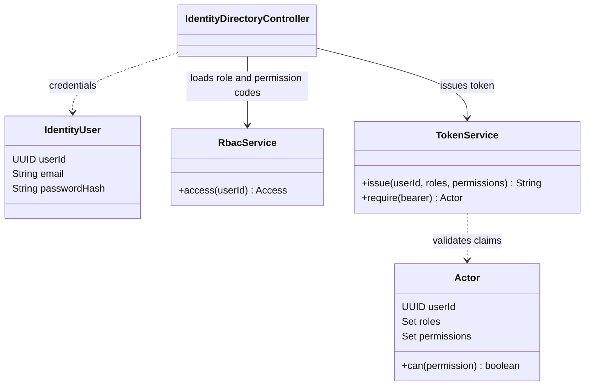
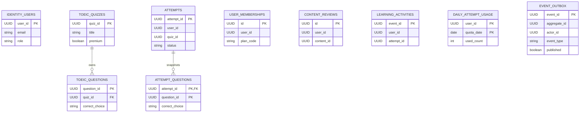

# Báo cáo KTHDV & KTPM — Bảng bằng chứng thực nghiệm

**Chỉ điền số liệu từ lần chạy có bằng chứng.** [Trạng thái xác minh](VALIDATION_STATUS.md) ghi nguồn kết quả và các phép thử còn thiếu.

## I. KTHDV — Hướng 3

| Tiêu chí | Bằng chứng cần chụp | Kết quả |
|---|---|---|
| 5 independent Core Microservices | `docker compose ps`, image/service logs | Đã cấu hình. Chờ ảnh runtime. |
| Independent Gateway | network tab: UI → :8088, nginx routes | Đã cấu hình. Smoke trước đó được báo đạt, chờ log và ảnh. |
| 5 databases | `docker compose exec <db> psql ... \l` | Có cấu hình và migrations riêng. Chờ ảnh hoặc output DB. |
| JWT roles/permissions | Quyền từ `/rbac/me`, HTTP và SQL COUNT theo vai trò | Learner bị từ chối tạo quiz và cấp role. Teacher tạo được quiz, bị từ chối cấp Admin. Admin cấp được Teacher và tạo được quiz. [Log QA-01](evidence/qa01-security-rbac-aa43453.txt) |
| Interaction records reviews + activity | UI screenshot and `interaction_db` rows | Smoke trước đó được báo đạt. Chờ log. |
| Membership FREE vs PRO | FREE trả 403, demo PRO mở được cùng quiz premium | FREE trả 403 với COUNT attempt giữ 0. Sau demo upgrade, PRO trả 200 và COUNT tăng 0 → 1. [Log QA-01](evidence/qa01-security-rbac-aa43453.txt) |
| No cross-database FK | ERD and migrations in each service | Đối chiếu migrations và mô hình sở hữu database. |
| Docker Compose | `docker compose config --quiet` & full stack boot | Config exit 0. Chờ bằng chứng full stack boot. |

### Class diagram for RBAC



`RbacService` reads role and permission assignments from `identity_user_roles` and `identity_role_permissions` using JDBC.

### ERD ownership (abbreviated)



`user_id`, `content_id`, `quiz_id` in other databases are IDs **without cross-database foreign keys**.

## II. KTPM — ADD / arc42 / C4

- arc42 1/3/4/5/6/7/9/10 sections are in the [architecture document](EXAM_ARCHITECTURE.md).
- At least 3 Quality Attribute Scenarios: QA-01, QA-02, QA-03, QA-04.
- Seven ADRs, including the Assessment aggregate and persistence ports. [ADR log](ADR_MVP.md)
- C4 L1, L2, L3 and Runtime/Deployment Mermaid diagrams in architecture file.
- Assessment bounded context, aggregate, invariants and Example Mapping. [Assessment DDD](ASSESSMENT_DDD.md)

### Experiment results (fill after actual tests)

| Experiment | Command | Expected | Observed | Screenshot |
|---|---|---|---|---|
| Assessment unit tests | `mvn -f assessment-service/pom.xml test` | domain rules and use-case orchestration | 12 passed in existing Surefire reports | Archive the two reports with run metadata. |
| Functional smoke | `python tests/smoke.py` | all enabled assertions pass | 10 checks passed per project owner | Raw output pending. |
| Daily quota concurrency | `python tests/test_quota_concurrency.py` | after 9 starts, parallel starts yield 1 HTTP 200 and 9 HTTP 429, total 10 | Passed per project owner | Raw output pending. |
| Performance 50 VUs / 60 s (QA-04) | `k6 run tests/load.js` | p95 < 500 ms, HTTP failures < 1%, all checks pass | **PASS, 2026-11-22.** 5,793 requests, 95.76 req/s, p95 29.18 ms, HTTP failures 0%, failed checks 0%. | [k6 console output](evidence/qa04-k6-20261122-run.txt) |
| Interaction down (QA-03 A) | `python -B -u tests/test_fault_injection.py` | Grade persists while Interaction is down. Queue holds the event and activity appears after recovery. | **PASS, 2026-11-22.** Submit HTTP 200 in 94.0 ms, `GRADED` 0/3. Queue `ready` increased 0 → 1 with zero consumers. Matching activity observed at recovery poll 5. | [QA-03 log, case A](evidence/qa03-fault-injection-20261122-134619.txt) |
| RabbitMQ down (QA-03 B) | `python -B -u tests/test_fault_injection.py` | Grade persists with outbox pending during outage. Same event is processed after recovery. | **PASS, 2026-11-22.** Submit HTTP 200 in 93.0 ms, `GRADED` 0/3. `published=false` in all 4 outage polls and 1 retry warning observed. Matching activity observed at recovery poll 6. | [QA-03 log, case B](evidence/qa03-fault-injection-20261122-134619.txt) |
| QA-01 Security / RBAC | `POST /ms/v1/contents/quizzes` và SQL COUNT trước/sau | Learner nhận 403, số quiz không đổi | **PASS, `aa43453`.** Tổng quiz 2 → 2, quiz theo mã lần chạy 0 → 0. Teacher và Admin mỗi lần nhận 200 và thêm đúng một quiz. | [Log QA-01](evidence/qa01-security-rbac-aa43453.txt) |
| No cross-user read | `GET /ms/v1/attempts/{id}` | Chủ sở hữu 200, người khác 404 | **PASS.** Cả Learner và Admin không sở hữu attempt đều nhận 404. | [Log QA-01](evidence/qa01-security-rbac-aa43453.txt) |
| Concurrent submit | `python -B -u tests/test_concurrent_submit.py` | 10 HTTP 200, identical grade, one outbox row | **PASS, 2026-11-22.** 10/10 HTTP 200, `GRADED` 0/3, 65.9–298.2 ms, one `AttemptGraded` row. | Log QA-02 với attempt `d59d38b4-cd72-4184-bf5a-40d396102609`. |

#### Kế hoạch chạy các phép thử

1. **k6 (QA-04).** Chạy preflight rồi chạy profile 50 VUs theo lệnh PowerShell bên dưới. Đường đọc đo là `GET /ms/v1/contents/quizzes` qua Gateway cục bộ, không cần JWT. Mỗi VU nghỉ 500 ms giữa các lượt. Script yêu cầu HTTP 200, JSON và một danh sách `QuizView` hợp lệ có dữ liệu seed. Tất cả check phải đạt cùng hai ngưỡng p95 < 500 ms và `http_req_failed` < 1%.
2. **Concurrent submit (QA-02).** Chạy [script QA-02](../tests/test_concurrent_submit.py) trên stack Compose đang hoạt động. Mỗi lần chạy đăng ký learner mới, mở một quiz FREE, lưu lựa chọn A và gửi 10 yêu cầu submit cùng JWT qua Gateway. Script ghi HTTP status, độ trễ và điểm của từng request, so sánh các phản hồi theo ID câu hỏi rồi truy vấn PostgreSQL ở chế độ chỉ đọc. Exit `0` khi cả 10 yêu cầu trả cùng kết quả `GRADED`, điểm khớp với snapshot đã lưu và outbox có đúng một sự kiện `AttemptGraded`. Exit `1` khi tiêu chí sai hoặc lỗi thiết lập. Exit `2` khi HTTP đạt nhưng thiếu xác minh DB.
3. **Fault injection (QA-03).** Chạy [quy trình PowerShell](../tests/fault_injection.md) để lưu log mới. Script dùng attempt và event ID riêng, đối chiếu HTTP, outbox, queue và Interaction DB. Lần chạy trên stack Windows tại checkout `f191b7a` quan sát activity qua API sau khoảng 23,64 giây (A) và 35,36 giây (B) tính từ lúc gửi submit. Các số đo này lấy từ timestamp lần polling đầu tiên thấy đúng event qua API. Cả 12 service ban đầu ở trạng thái running khi kết thúc. [Bằng chứng QA-03](evidence/qa03-fault-injection-20261122-134619.txt)

#### Kết quả QA-04 ngày 2026-11-22

| Chỉ số | Kết quả |
|---|---:|
| Requests / throughput | 5,793 / 95.76 req/s |
| p50 / p90 / p95 / p99 | 6.75 / 18.08 / 29.18 / 572.13 ms |
| HTTP request failure rate | 0% (0/5,793) |
| Check failure rate | 0% (0/17,379) |
| k6 exit code | 0 |

Checkout `19aa006`, Windows 11 x64, AMD Ryzen 7 6800H (8 nhân, 16 luồng), RAM 7.19 GiB. Docker Desktop Engine 29.8.2, Compose 5.5.1, Docker báo 16 CPU và 3.43 GiB RAM. k6 v2.4.0 chạy trên cùng máy với Gateway. Preflight 2 VUs trong 5 giây gửi 20 requests với 60/60 checks đạt. Dữ liệu thử gồm hai quiz. p99 là 572.13 ms, cao hơn mốc 500 ms dùng cho p95. [Preflight và cấu hình máy](evidence/qa04-k6-20261122-preflight.txt) · [Summary JSON](evidence/qa04-k6-20261122-summary.json)

Ghi kèm commit, ngày giờ, cấu hình máy, trạng thái Compose và dữ liệu thử đã ẩn JWT hoặc khóa dịch vụ. Log QA-01 ghi timestamp, SHA checkout, HTTP status và SQL COUNT. Tài khoản Admin cần cho phép thử được provision riêng và đăng nhập đã bị vô hiệu hóa sau khi chạy. [Log QA-01](evidence/qa01-security-rbac-aa43453.txt)

#### Chạy lại QA-04 trên Windows

Nếu chưa có k6, chạy `winget install k6 --source winget`, rồi mở PowerShell mới. Từ thư mục gốc repository, xác nhận `docker compose ps` hiển thị Gateway, Content Service và Content DB đang chạy. [Hướng dẫn cài k6](https://grafana.com/docs/k6/latest/set-up/install-k6/)

```powershell
$env:GATEWAY_URL = 'http://127.0.0.1:8088'
$env:K6_NO_USAGE_REPORT = 'true'
$qa04Stamp = Get-Date -Format 'yyyyMMdd-HHmmss'
$qa04Preflight = "docs/evidence/qa04-k6-$qa04Stamp-preflight.txt"
$qa04Run = "docs/evidence/qa04-k6-$qa04Stamp-run.txt"
$qa04Summary = "docs/evidence/qa04-k6-$qa04Stamp-summary.json"
k6 run --quiet --no-color --vus 2 --duration 5s tests/load.js 2>&1 |
    Tee-Object -FilePath $qa04Preflight
if ($LASTEXITCODE -ne 0) { throw 'QA-04 preflight failed' }
k6 run --quiet --no-color --vus 50 --duration 60s --summary-export $qa04Summary tests/load.js 2>&1 |
    Tee-Object -FilePath $qa04Run
$qa04Exit = $LASTEXITCODE
"QA-04 k6 exit code: $qa04Exit" | Tee-Object -FilePath $qa04Run -Append
```

#### Lưu bằng chứng QA-02 trên Windows

Tại thư mục gốc repository, mở PowerShell và chạy các lệnh sau khi stack đã sẵn sàng. Nếu stack chưa chạy, khởi động bằng `docker compose up -d --build` trước.

```powershell
$gatewayAddress = docker compose port gateway 8088
if ($LASTEXITCODE -ne 0) { throw 'Gateway Compose chưa sẵn sàng' }
$env:GATEWAY_URL = 'http://' + $gatewayAddress.Trim()
$qa02Log = Join-Path $env:TEMP ('toeic-qa02-' + (Get-Date -Format 'yyyyMMdd-HHmmss') + '.txt')
"Git HEAD: $(git rev-parse --short HEAD)" | Tee-Object -FilePath $qa02Log
python -B -u tests/test_concurrent_submit.py | Tee-Object -FilePath $qa02Log -Append
$qa02Exit = $LASTEXITCODE
"QA-02 exit code $qa02Exit" | Tee-Object -FilePath $qa02Log -Append
Write-Output "Evidence file $qa02Log"
```

### Suggested screenshot set

1. Login / learner homepage / quiz list
2. Exam in progress (no answer key) / graded result (explanations)
3. FREE denied for PRO quiz / PRO demo activation
4. Content/Identity/Assessment/Interaction/Membership logs and `docker compose ps`
5. RabbitMQ management queue + activity received after Interaction restart
6. k6 summary with requests, p95 and failures

### Final conclusion template

> Trong môi trường [MÁY], ngày [NGÀY], hệ thống chạy [SỐ] container. Kịch bản QA-01 ... [SỐ LIỆU]. Những kịch bản chưa đạt: ... Phân tích nguyên nhân: ... Biện pháp cải tiến: ...

## III. Limitations to disclose in report

This bundle is an integrated **TOEIC MVP**; it does not migrate all original source features. The original project is a Spring Boot modular monolith with mature question bank, assessment, SRS and RAG. The demo's compact service code has not yet been reorganized to a literal `entrypoints/core/data` boilerplate. Any requirement for full original feature parity or strict provided boilerplate remains future work. Execution evidence must be captured on a machine capable of Docker+Maven dependency resolution.
