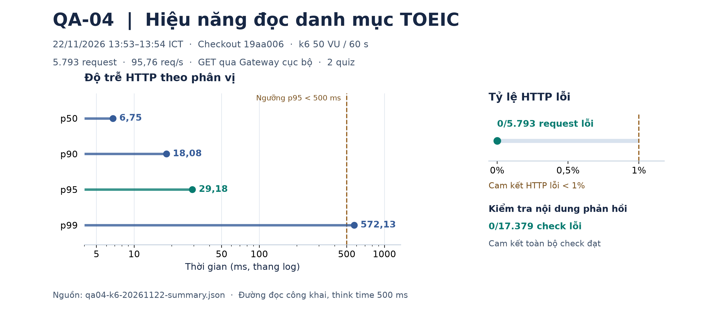

# Bộ bằng chứng nộp KTPM / KTHDV

Revision mã đã xác minh trên GitHub là `730dd5cca4a9f8690720b4379bda8458e64707e0`, nhánh `refactor/remaining-layered-services`. CI 45022782408 hoàn tất thành công 6/6 job ngày 22/11/2026 lúc 19:32:34 ICT (12:32:34 UTC theo GitHub). Các số đo QA bên dưới thuộc các lần chạy lịch sử. SHA là checkout được ghi trong log, trừ QA-02 thiếu metadata này. [Revision](https://github.com/chienvoxn/toeic-learning-platform-microservices/commit/730dd5cca4a9f8690720b4379bda8458e64707e0) · [CI](https://github.com/chienvoxn/toeic-learning-platform-microservices/actions/runs/45022782408) · [Phạm vi validation](VALIDATION_STATUS.md).

## QA-01–04

| Kịch bản | Thời điểm gốc và SHA | Cam kết và kết quả quan sát | Giới hạn phép thử |
|---|---|---|---|
| QA-01 · Security/RBAC | 22/11/2026 18:33:41.512–18:34:01.342 ICT (UTC+7), checkout `aa43453` | **PASS.** Learner tạo đề bị 403, tổng số đề 2 → 2 và số đề mang tiêu đề thử 0 → 0. Teacher/Admin mỗi vai trò tạo được một đề. Admin cấp Teacher thành công, Learner/Teacher bị từ chối khi cấp quyền. Owner đọc attempt 200, Learner/Admin khác nhận 404. Cùng đề Premium, FREE nhận 403 và số attempt 0 → 0, PRO demo nhận 200 và 0 → 1. | Một lượt với dữ liệu thử chuyên biệt trên stack Compose đang chạy, dùng API và COUNT SQL. Demo PRO bật, Admin thử đã vô hiệu hóa đăng nhập. Chỉ bao phủ các quyền và tài nguyên đã kiểm tra. [Log QA-01](evidence/qa01-security-rbac-aa43453.txt) |
| QA-02 · Concurrent submit | 22/11/2026 06:40:35.606254 UTC (13:40:35 ICT), SHA checkout và image chưa ghi | **PASS cho lượt ghi log.** 10/10 submit trả 200 và cùng kết quả `GRADED` 0/3. SQL xác nhận điểm snapshot và đúng một dòng `AttemptGraded`. Độ trễ quan sát 65,9–298,2 ms. | Một attempt, 10 request, một stack Windows/Compose. Chưa gắn được kết quả với revision nộp. [Log QA-02](evidence/qa02-concurrent-submit.txt) |
| QA-03 · Availability | 22/11/2026 06:46:20.379–06:47:45.340 UTC (13:46–13:47 ICT), checkout `f191b7a` | **PASS A/B.** A dừng Interaction, submit 200/94,0 ms, queue ready 0 → 1 và 0 consumer. B dừng RabbitMQ, submit 200/93,0 ms và Outbox giữ `published=false` trong 4 poll. Cả hai lưu điểm ngay khi dependency ngừng. Từ lúc Compose báo running/healthy đến poll đầu thấy cùng `eventId` qua SQL và API là 12,697 s (A, poll 5) và 16,169 s (B, poll 6), dưới cửa sổ 60 s. | Hai lỗi tách riêng trên một stack, Assessment và DB của nó hoạt động. Thời gian dựa trên poll quan sát, phụ thuộc chu kỳ poll. Publisher confirms chưa được triển khai. [Log QA-03](evidence/qa03-fault-injection-20261122-134619.txt) |
| QA-04 · Performance | 22/11/2026 13:53:11.465629–13:54:12.438345 ICT (UTC+7), checkout `19aa006` | **PASS theo ngưỡng dự án.** 50 VU / 60 s, 5.793 request, 95,76 req/s, p95 29,18 ms (< 500 ms), HTTP lỗi 0/5.793 (< 1%), check lỗi 0/17.379. p50 6,75 ms, p90 18,08 ms, p99 572,13 ms. | Một lượt k6 v2.4.0, Windows 11 và Docker Desktop trên cùng máy với Gateway, 500 ms think time, hai quiz seed, GET danh mục công khai qua loopback, không đăng nhập. Ngưỡng 500 ms áp dụng cho p95. Phạm vi đo là đường đọc danh mục và không đại diện cho submit, tải hỗn hợp hay production. [Môi trường và preflight](evidence/qa04-k6-20261122-preflight.txt) · [Console](evidence/qa04-k6-20261122-run.txt) · [JSON](evidence/qa04-k6-20261122-summary.json) |

### Biểu đồ QA-04

*Hình QA-04. Biểu đồ dựng từ `http_req_duration`, `http_req_failed`, `http_reqs` và `checks` trong summary JSON. Trục độ trễ dùng thang log để thấy cả p50 và p99. Tỷ lệ HTTP lỗi dùng `http_req_failed.value`, đối chiếu với các bộ đếm và console. Số liệu giữ nguyên phiên chạy ghi ở bảng.*

## Sơ đồ cho báo cáo

Các PNG dưới đây được kết xuất từ Mermaid trong hồ sơ thiết kế. Dùng chú thích và link nguồn khi đưa vào báo cáo.

| Hình | Chú thích và nguồn |
|---|---|
| [C4 L1](figures/c4-l1.png) | Context của TOEIC MVP với Learner, Teacher và Admin. [Mermaid](EXAM_ARCHITECTURE.md#3-arc42--context-and-scope-c4-level-1) |
| [C4 L2](figures/c4-l2.png) | Gateway, năm service, năm database và RabbitMQ. [Mermaid](EXAM_ARCHITECTURE.md#5-arc42--building-block-view-c4-level-2) |
| [C4 L3](figures/c4-l3-assessment.png) | Thành phần Assessment và hướng phụ thuộc. [Mermaid](EXAM_ARCHITECTURE.md#c4-level-3--assessment-components) |
| [Sequence QA-03](figures/qa03-recovery.png) | Thiết kế luồng chấm và phục hồi qua Outbox ở hai nhánh lỗi. Kết quả quan sát nằm ở bảng QA-03. [Mermaid](EXAM_ARCHITECTURE.md#qa-03-availability-and-recovery) |
| [Deployment](figures/deployment.png) | Hạ tầng demo cục bộ, mạng Compose và cổng host. [Mermaid](EXAM_ARCHITECTURE.md#7-arc42--deployment-view-docker-compose) |
| [Class Diagram RBAC](figures/rbac.png) | User–Role–Permission và ánh xạ quyền của Identity. [Mermaid](REPORT_TEMPLATE.md#class-diagram-for-rbac) |
| ERD · [Identity](figures/erd-identity.png), [Content](figures/erd-content.png), [Assessment](figures/erd-assessment.png), [Interaction](figures/erd-interaction.png), [Membership](figures/erd-membership.png) | Năm ERD theo database và tham chiếu logic qua ID. [Mermaid và ghi chú ownership](REPORT_TEMPLATE.md#erd-ownership-five-databases) |

## Ảnh chụp demo còn chờ

Khi rehearsal trên stack sẵn sàng, chụp trực tiếp các khung dưới đây. Ghi timestamp có múi giờ, checkout SHA và nguồn hình cho từng ảnh. Che mật khẩu, JWT, Authorization header, cấu hình resolved và dữ liệu cá nhân trước khi đưa vào báo cáo.

1. `docker compose ps -a` và probe danh mục qua Gateway sau readiness.
2. Learner làm đề FREE, màn hình kết quả có `GRADED` và lịch sử.
3. Cùng đề Premium trước và sau khi kích hoạt PRO demo.
4. Admin cấp Teacher và Teacher xuất bản đề sau lần đăng nhập mới.
5. Review và activity `ATTEMPT_GRADED`, đối chiếu attempt ID.

Hồ sơ hiện có biểu đồ thực nghiệm QA-04, sơ đồ thiết kế và log gốc. Ảnh chụp giao diện chạy đủ các luồng demo vẫn chờ rehearsal. [Kịch bản demo](../README.md#4-kịch-bản-demo-learner--teacher--admin).
